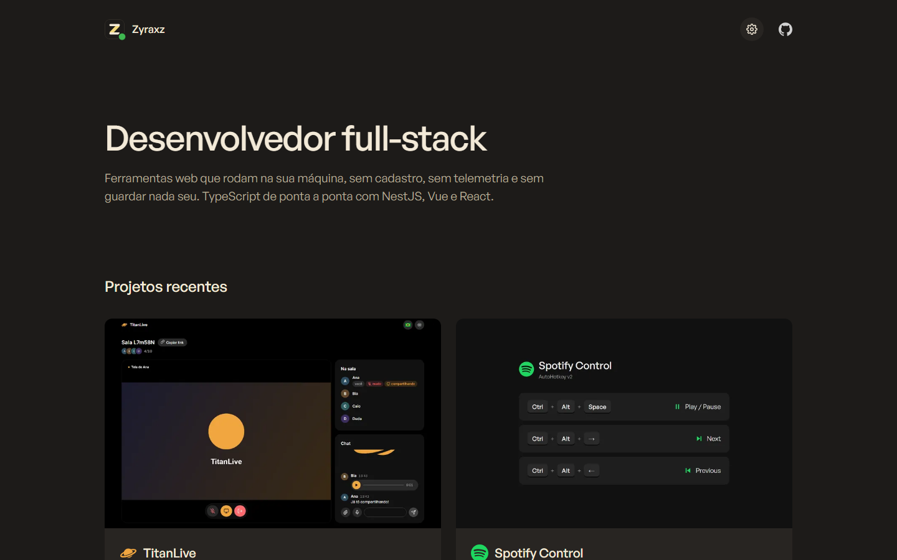

<p align="center">
  
</p>

<h1 align="center">Zyraxz</h1>

<p align="center">
  <b>English</b> · <a href="README.pt-BR.md">Português (Brasil)</a>
</p>

<p align="center">
  My portfolio: projects, stack and what I'm committing right now. A static site with no build step, no trackers and no third-party requests.
</p>

<p align="center">
  
  
  
  
  
  
</p>

<p align="center">
  <a href="https://samuelschutz13.github.io/Zyraxz-website/"><b>samuelschutz13.github.io/Zyraxz-website</b></a>
</p>

<p align="center">
  
</p>

> [!NOTE]
> **No trackers, no third parties.** The font and every icon are served by the site itself. On the published site the GitHub data comes from a file built during the deploy, so visitors never talk to anyone but GitHub Pages.

## Features

- **Recent projects**: the two repositories pushed most recently, then **all projects** below, newest first, with a **filter by technology**.
- **Timeline**: one stop per day showing which projects were born when.
- **Project pages** with features, architecture, a privacy note and screenshots that open full size (arrows move between them).
- **About me** (its own page, `sobre.html`): stack grouped by languages, frameworks, databases and testing, each linking to its official site; **recent commits** with each app's icon; a **languages bar** with the share of each language across my repositories; and the **contributions calendar** of the last year.
- **Online status**: hover the name to see whether I committed in the last 24 hours, when and in which app.
- **Settings** (⚙): pastel **light and dark themes**, **Portuguese and English** with flags. Both are remembered.
- WebP screenshots with thumbnails for the cards, scroll reveal that respects reduced motion, a 404 page, `sitemap.xml`, canonical links and Open Graph previews.

## Getting started

There is nothing to install. Clone it and serve the folder:

```sh
git clone https://github.com/SamuelSchutz13/Zyraxz-website.git
cd Zyraxz-website

python -m http.server 8000   # or: npx serve
```

Open **http://localhost:8000**. Opening `index.html` straight from disk works too; the GitHub data then comes from the public API (60 requests per hour, cached for 15 minutes).

To build the GitHub data file locally, as the deploy does:

```sh
GITHUB_TOKEN=$(gh auth token) node .github/scripts/github-data.mjs   # writes assets/data/github.json
```

### Deploy

`.github/workflows/deploy.yml` publishes the site to GitHub Pages (source: **GitHub Actions**).

| When                  | What happens                                                          |
| --------------------- | --------------------------------------------------------------------- |
| Push to `main`        | Fetches the GitHub data and publishes                                 |
| Every hour (`:17`)    | Same, so stars, recent projects, commits and status stay fresh        |
| Manually              | `gh workflow run deploy.yml` or the **Run workflow** button           |

If the data step fails the site is still published, and the browser falls back to the public API.

## How it works

```
GitHub Actions (hourly)  →  github-data.mjs  →  assets/data/github.json  →  GitHub Pages
browser  →  index.html + assets/js/*  →  github.json (or api.github.com when opened from disk)
```

- **Languages**: every text exists in both languages in the HTML, marked `lang="pt"` or `lang="en"`. CSS hides the inactive one, so there is no translation file and no extra request.
- **Theme and language** are applied in `<head>`, before the first paint, so the page never flashes the wrong theme.
- **GitHub data**: stars, last push per repository (which decides the recent projects), the seven latest commits of the four most active repositories, bytes of code per language, and the contributions calendar, read from GitHub's public HTML fragment.
- **Online**: green when the latest commit is less than 24 hours old.

### Project structure

```
index.html                home page
sobre.html                about me: stack, commits, languages and contributions
404.html                  "not found" page (GitHub Pages)
projects/*.html           one page per main project
sitemap.xml, robots.txt   for search engines
assets/
  css/main.css            styles, light/dark themes and languages
  fonts/                  General Sans (woff2)
  js/prefs.js             theme and language from the settings popup, applied before paint
  js/filters.js           technology filter for the projects
  js/github.js            stars, recent projects, commits, contributions and online status
  js/reveal.js            cards rising in on scroll
  js/lightbox.js          full-size screenshots
  img/logos/              project icons (from each repository)
  img/icons/              technology icons
  img/projects/           screenshots in WebP (thumbs/ holds the 800 px card versions)
.github/
  workflows/deploy.yml    deploy on push and hourly
  scripts/github-data.mjs builds assets/data/github.json
```

## Known limitations

- **"Online" is not live.** It means "committed in the last 24 hours", and the data refreshes once an hour.
- GitHub pauses scheduled workflows after 60 days without activity in the repository. Any push or a manual run turns them back on.
- The contributions calendar is read from GitHub's HTML, so a change in their markup can hide it until the script is updated.
- The settings popup uses the HTML `popover` attribute, available in current Chrome, Edge, Firefox and Safari.

## Credits

- Font: [General Sans](https://www.fontshare.com/fonts/general-sans) by Indian Type Foundry (ITF Free Font License), served by the site itself.
- Technology icons: [Simple Icons](https://simpleicons.org) (CC0). Playwright logo from [playwright.dev](https://playwright.dev).
- Screenshots and project icons come from each project's own repository.
