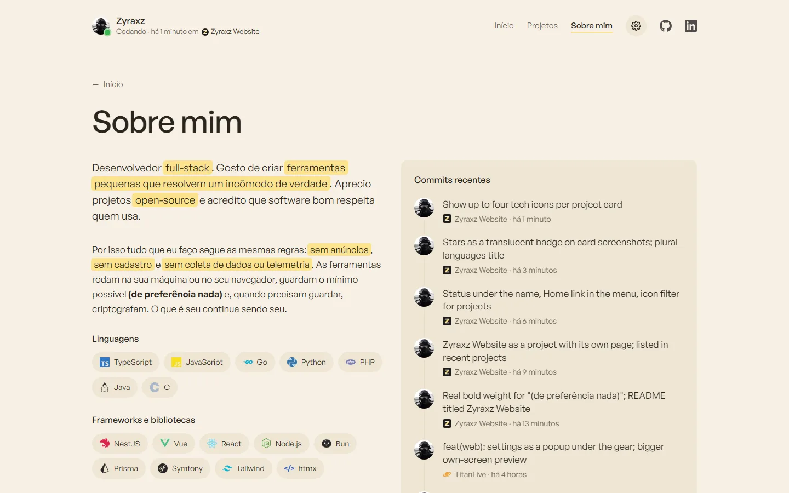
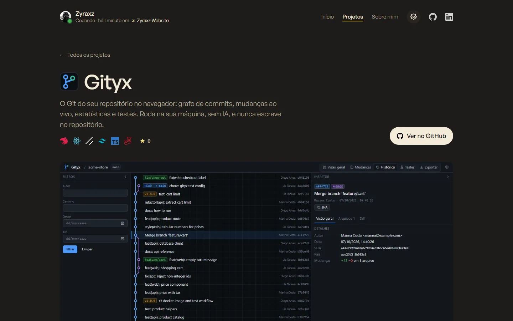

<p align="center">
  
</p>

<h1 align="center">Zyraxz Website</h1>

<p align="center">
  <a href="README.md">English</a> · <b>Português (Brasil)</b>
</p>

<p align="center">
  Meu portfólio: projetos, stack e o que estou commitando agora. Um site estático, sem build, sem rastreadores e sem pedidos a terceiros.
</p>

<p align="center">
  
  
  
  
  
  
</p>

<p align="center">
  <a href="https://samuelschutz13.github.io/Zyraxz-website/"><b>samuelschutz13.github.io/Zyraxz-website</b></a>
</p>

<p align="center">
  
</p>

> [!NOTE]
> **Sem rastreadores e sem terceiros.** A fonte e todos os ícones são servidos pelo próprio site. No site publicado, os dados do GitHub vêm de um arquivo gerado durante o deploy, então o visitante só conversa com o GitHub Pages.

## Funcionalidades

- **Projetos recentes**: os dois repositórios com push mais recente, e logo abaixo **todos os projetos**, do mais novo para o mais antigo, com **filtro por tecnologia** (um ícone por tecnologia).
- **Linha do tempo**: um ponto por dia mostrando quando cada projeto nasceu.
- **Página de cada projeto** com funcionalidades, arquitetura, nota de privacidade e capturas que abrem em tela cheia (com setas entre elas).
- **Sobre mim** (página própria, `sobre.html`): stack dividida em linguagens, frameworks, bancos e testes, cada uma com link para o site oficial; **commits recentes** com o ícone de cada app; uma **barra de linguagens** com a fatia de cada linguagem nos meus repositórios; e o **calendário de contribuições** do último ano.
- **Status "codando"** embaixo do nome: mostra se commitei nas últimas 24 horas, quando e em qual app.
- **Configurações** (⚙): **tema claro e escuro** em tons pastel, **português e inglês** com bandeiras. As escolhas ficam salvas.
- Capturas em WebP com miniaturas para os cartões, animação ao rolar que respeita "reduzir movimento", página 404, `sitemap.xml`, links canônicos e prévia ao compartilhar (Open Graph).

## Telas

**Sobre mim** no tema claro: stack, commits recentes, linguagens e contribuições.

<p align="center"></p>

**Página de projeto**: funcionalidades, como funciona e capturas que abrem em tela cheia.

<p align="center"></p>

## Como rodar

Não há nada para instalar. Clone e sirva a pasta:

```sh
git clone https://github.com/SamuelSchutz13/Zyraxz-website.git
cd Zyraxz-website

python -m http.server 8000   # ou: npx serve
```

Abra **http://localhost:8000**. Abrir o `index.html` direto do disco também funciona; nesse caso os dados do GitHub vêm da API pública (60 consultas por hora, com cache de 15 minutos).

Para gerar o arquivo de dados do GitHub localmente, como o deploy faz:

```sh
GITHUB_TOKEN=$(gh auth token) node .github/scripts/github-data.mjs   # escreve assets/data/github.json
```

### Deploy

O `.github/workflows/deploy.yml` publica o site no GitHub Pages (fonte: **GitHub Actions**).

| Quando                 | O que acontece                                                            |
| ---------------------- | ------------------------------------------------------------------------- |
| Push na `main`         | Busca os dados do GitHub e publica                                        |
| De hora em hora (`:17`)| O mesmo, para estrelas, projetos recentes, commits e status ficarem em dia |
| Manualmente            | `gh workflow run deploy.yml` ou o botão **Run workflow**                  |

Se a busca de dados falhar, o site é publicado mesmo assim, e o navegador usa a API pública como reserva.

## Como funciona

```
GitHub Actions (de hora em hora)  →  github-data.mjs  →  assets/data/github.json  →  GitHub Pages
navegador  →  index.html + assets/js/*  →  github.json (ou api.github.com quando aberto do disco)
```

- **Idiomas**: cada texto existe nas duas línguas no próprio HTML, marcado com `lang="pt"` ou `lang="en"`. O CSS esconde o inativo, então não há arquivo de tradução nem pedido extra.
- **Tema e idioma** são aplicados no `<head>`, antes de pintar a tela, então a página nunca pisca com o tema errado.
- **Dados do GitHub**: estrelas, último push de cada repositório (que decide os projetos recentes), os sete commits mais novos dos quatro repositórios mais ativos, bytes de código por linguagem e o calendário de contribuições, lido do fragmento HTML público do GitHub.
- **Codando**: verde quando o último commit tem menos de 24 horas.

### Estrutura

```
index.html                página inicial
sobre.html                sobre mim: stack, commits, linguagens e contribuições
404.html                  página de "não encontrado" (GitHub Pages)
projects/*.html           uma página por projeto
sitemap.xml, robots.txt   para buscadores
assets/
  css/main.css            estilos, temas claro/escuro e idiomas
  fonts/                  General Sans (woff2)
  js/prefs.js             tema e idioma do popup de configurações, aplicados antes de pintar a tela
  js/filters.js           filtro de projetos por tecnologia
  js/github.js            estrelas, projetos recentes, commits, contribuições e status online
  js/reveal.js            cartões surgindo ao rolar
  js/lightbox.js          capturas em tela cheia
  img/logos/              ícones dos projetos (de cada repositório)
  img/icons/              ícones das tecnologias
  img/projects/           capturas em WebP (thumbs/ tem as versões de 800 px dos cartões)
.github/
  workflows/deploy.yml    deploy a cada push e de hora em hora
  scripts/github-data.mjs gera assets/data/github.json
```

## Limitações conhecidas

- **"Codando" não é em tempo real.** Quer dizer "commitou nas últimas 24 horas", e os dados atualizam uma vez por hora.
- O GitHub pausa workflows agendados depois de 60 dias sem atividade no repositório. Qualquer push ou execução manual liga de novo.
- O calendário de contribuições é lido do HTML do GitHub; se eles mudarem a marcação, ele some até o script ser atualizado.
- O popup de configurações usa o atributo `popover` do HTML, disponível nas versões atuais do Chrome, Edge, Firefox e Safari.

## Créditos

- Fonte: [General Sans](https://www.fontshare.com/fonts/general-sans), da Indian Type Foundry (ITF Free Font License), servida pelo próprio site.
- Ícones das tecnologias: [Simple Icons](https://simpleicons.org) (CC0). Logo do Playwright do [playwright.dev](https://playwright.dev).
- As capturas e os ícones dos projetos vêm do repositório de cada projeto.
